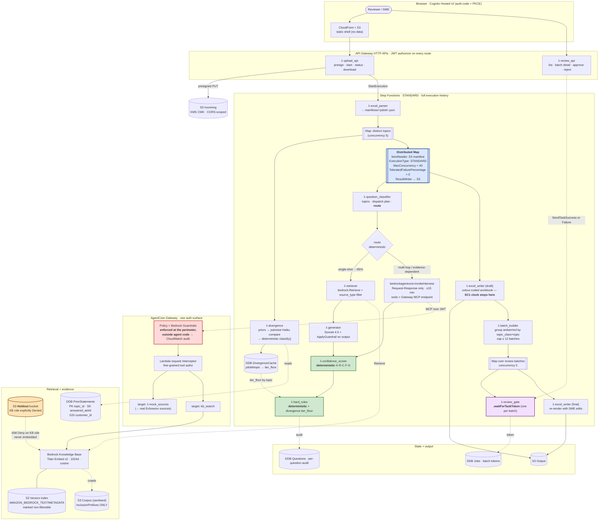

# ENG-2 Echoworx questionnaire copilot — target architecture (Bolt 2)

**Engagement:** ENG-2 Echoworx PoC · **Bolt:** 2 · **Author:** solutions-architect
**Baseline:** `rfp-copilot` @ `739133b`, branch `echoworx-wiring` (v0.5 design contract in `docs/architecture.md`)
**Region:** `us-east-1` · **Account:** VeUP ephemeral PoC-OU · **TTL:** 2026-10-11 · **Budget ceiling:** USD 1,500
**Status:** G2 Architecture evidence. Proposed, not approved. No Gate Verdict is set by this document.

AWS facts in this document were re-verified **27 Aug 2026** against current AWS documentation. Every claim
that could not be confirmed is marked **[UNVERIFIED]** in §9 rather than asserted.

---

## 1. What this system is, in one paragraph

Echoworx receives inbound security assessments (CAIQ v4, SIG, VSA) as Excel workbooks and burns senior SME
time re-answering substantially the same controls. The pipeline parses the workbook, answers each question
from an evidence corpus with citations, scores confidence **deterministically**, forces tier floors through a
**deterministic** rules engine, routes only the uncertain items to a human in topic-sized batches, and emits a
colour-coded workbook. The commercial question the PoC settles is not "can a model write a plausible answer"
but "how much SME time is removed, how accurate is the output, and can a compliance function audit it."
Everything below is subordinate to that last clause.

---

## 2. Locked decisions this design sits inside

These were set by the human and by `HANDOFF.md` §2. They are not relitigated here.

| Lock | Consequence for this design |
|---|---|
| Step Functions stays the orchestrator | The spine is a bounded, auditable state machine. Agentic behaviour is a *state inside it*, never the driver. |
| AgentCore used in exactly three places: Gateway, harness inside the Map, Evaluations | Out: Memory, Code Interpreter, Agent Registry, payments, Web Search, Browser. Identity is phase 2. |
| Retrieval = Bedrock Knowledge Bases over S3 Vectors + Titan Embed v2 | No OpenSearch Serverless anywhere in this design. |
| `confidence_scorer` and `hard_rules` stay deterministic Lambdas | No model output may exist on the path *into* either. SC3 is a diff of two runs = 0 tier changes. |
| Customer names ride as sidecar metadata, never embedded chunk text | Enforced mechanically via `includeForEmbedding: false` — see ADR-10 and §6.2. |
| S3 Vectors filterable metadata ≤ 2048 bytes/vector | Sidecars stay flat and small. Nested structures are not filterable. |
| Sidecar dates are ISO-8601 strings | KB metadata filters compare lexically; ISO-8601 sorts correctly as a string. Do not "tidy" to epoch ints. |
| Bedrock KB custom transformation is POST_CHUNKING only | Anything that must happen before Bedrock sees raw text runs *upstream of the KB entirely*, in the ingest gate. |
| `us-east-1`, residency out of scope (NG2) | Additionally validated below: AgentCore Policy+Guardrails is only in 5 regions and `ca-central-1` is not one of them. |

**One inherited constraint is now load-bearing in a way it was not before.** AgentCore Policy with Bedrock
Guardrails went GA 17 Jun 2026 in **US East (N. Virginia), Europe (London), Europe (Stockholm), Asia Pacific
(Sydney), Asia Pacific (Tokyo)** only. `ca-central-1` is absent. The region lock (NG2) is therefore not merely
a convenience — SC4 ("guardrail enforced outside agent code") is **only buildable in `us-east-1`** among the
regions this engagement would plausibly consider. Verified 27 Aug 2026.

---

## 3. What changes from v0.5

v0.5 is a deployed, tested, 30-question sales-side demo. The delta to a 250–2,000-question inbound compliance
tool is five structural changes and one deletion.

| # | v0.5 today | Target | Why |
|---|---|---|---|
| 1 | `sfn.Map`, `maxConcurrency: 10`, `itemsPath: $.parsed.questions` (inline payload) | **Distributed Map**, `ItemReader` over the S3 question manifest, `ExecutionType: STANDARD` children | 250 questions inline is near/over the 256 KB state payload limit; concurrency 10 gives ~30-question throughput. |
| 2 | `parse → Map → write → waitForTaskToken` (one token for the whole job, and the workbook is written *before* review, so approvals never reach a workbook) | `parse → divergence pre-pass → Distributed Map → draft write → batch builder → **Map over review batches**, one token per batch → **final write**` | One token per question is unusable at 250 items; one token for the whole job cannot route by topic or parallelise SMEs; and the current order loses SME edits. |
| 3 | `retriever → generator` fixed pair for every question | Deterministic classifier fork: **single-shot path** (existing pair) vs **AgentCore harness path** for multi-hop/evidence-dependent questions | Multi-hop questions ("describe key rotation for CMKs *and how you evidence it to auditors*") are under-served single-shot. Bounded so cost and variance stay controlled. |
| 4 | `mock_sources` Lambda called directly by the retriever over an unauthenticated HTTP API | `mock_sources` becomes a **Gateway Lambda target**; AgentCore Gateway is the single MCP/auth surface for non-KB sources, with Policy + Guardrails + a request Interceptor at the perimeter | SC4. Also the strongest security-buyer talking point in the design. |
| 5 | No evaluation harness, no holdout enforcement beyond `enabled: false` in `config/sources.yaml` | Holdout physically separated (own bucket + IAM deny on the KB role) + deterministic eval harness owning SC2 | `enabled: false` is a config flag one person can flip. SC2 requires *proof* the holdout was never embedded. |
| 6 | Public CloudFront UI, `allowOrigins: ['*']` on both HTTP APIs, personal domain, account `658203403363` in `cdk.context.json`/`outputs.json` | Cognito user pool, JWT authorizers on all APIs, context-driven domain/CORS, context files deleted and gitignored | UOW-1. The bucket now holds a security vendor's control documentation. |

**Deletion:** the sales-side RFP framing (NG9). `pricing` and `customer_reference` topics stay in the dispatch
table because their *mechanism* (force-tier RED, reference gating) is exactly what a questionnaire needs for
sub-processor and commercial-exposure questions — the topic names change, the machinery does not.

---

## 4. Target pipeline



**Reading the diagram.** Green = deterministic, no model output on the inbound path (SC3). Red = the guardrail
perimeter (SC4). Amber = the holdout, which the KB service role is cryptographically unable to read (SC2).
Blue = the scale-out. Purple = the human gate, and note it is **outside** the Distributed Map — that is not
cosmetic, see §5.2.

---

## 5. The three structural moves, in detail

### 5.1 Distributed Map (UOW-5a)

Verified 27 Aug 2026:
- Distributed mode is supported in **Standard** parent workflows only; children may be `EXPRESS` or `STANDARD`.
- Default `MaxConcurrency` is 10,000 parallel child executions.
- `ItemReader` reads from S3 (JSON/CSV) or an inline JSON payload; `ItemBatcher`, `ResultWriter`,
  `ToleratedFailurePercentage`/`ToleratedFailureCount` are all available.
- **Express workflows do not support `.waitForTaskToken` or `.sync`**, max duration 5 minutes, and Step
  Functions captures **no execution history** for them (CloudWatch Logs only), with *at-least-once* semantics.

Design consequences, in order of importance:

1. **Children are `STANDARD`, not `EXPRESS`.** SC3 requires an execution trace showing no model output on the
   path into `confidence_scorer`/`hard_rules`. Express children produce no Step Functions execution history,
   so that evidence would have to be reconstructed from logs — weaker, and exactly the kind of thing a
   compliance reviewer pushes back on. Express also caps at 5 minutes, which a `invokeHarness` call (up to 15
   minutes) can exceed. Cost of Standard children at this scale is negligible: ~250 questions × ~7 states ≈
   1,750 state transitions ≈ **USD 0.04/run** at $0.025 per 1,000 transitions.
2. **`ItemReader` over `manifests/<jobId>.json`, not the inline payload.** `excel_parser` already writes that
   manifest to the output bucket (`props.outputBucket.grantWrite(parserFn)`); today it *also* returns questions
   inline and the Map reads `$.parsed.questions`. At 250+ questions the inline form approaches the 256 KB state
   payload limit. Switch the Map to `ItemReader`; keep the inline return for the eval harness's small fixtures.
3. **`MaxConcurrency` is set by the Bedrock TPS quota, not by Step Functions.** Start at **40** and treat it as
   the tuning knob. Distributed Map will happily run 10,000 children and turn a questionnaire into a wall of
   `ThrottlingException`. The existing per-task retry (`maxAttempts: 5`, `backoffRate: 2`) stays and is the
   safety net; concurrency is the primary control.
4. **`ToleratedFailurePercentage` must be > 0.** Default 0 means one failed question fails the whole Map Run,
   which fails a 250-question job on one poison cell. Set ~2% and have the writer render unprocessed cells as
   RED with a `processing_failed` trigger. SC1's "0 unhandled task failures" is then a property of the job, not
   a hostage to one malformed row.
5. **`ResultWriter` → S3.** Per-question results already land in DynamoDB, but the Map Run result manifest in
   S3 is the cheapest input for the UOW-9 evidence pack and for the batch builder.

**No `ItemBatcher` on the question Map.** Batching questions into one child would amortise cold starts but
couples unrelated questions into a shared failure and blurs the per-question audit record. Batching happens on
the *review* side, where it buys something (§5.2).

### 5.2 Topic-batched SME review gate (UOW-5b)

The review gate sits **after** the Distributed Map, in the parent Standard workflow. It has to: Distributed Map
children can be Express, and even Standard children inside a Map Run are the wrong place to park a human for
hours — a paused child holds a Map Run slot and the Map Run's own timeout applies.

Flow: draft write → `batch_builder` → plain `Map` over batches (concurrency 5) → one
`review_gate.waitForTaskToken` per batch → final write.

`batch_builder` groups amber/red questions by `(topic_class, topic)` — the taxonomy already exists in
`question_classifier/dispatch.py` (`auth_compliance` / `auth_product` / `gated` / `unclassified`) — then merges
small groups until the batch count is **≤ 12** and each batch is roughly 10–30 questions. A CAIQ v4 workbook of
250 questions with a plausible 40% amber/red rate is ~100 review items → ~8 batches. The SME sees eight
screens of *related* controls, not a hundred context-switches; and because it is a Map, two SMEs can work two
batches concurrently.

Bounded by design: `waitForTaskToken` has no heartbeat today. Add a `heartbeatTimeout` and a
`TimeoutSeconds` on the batch task for the PoC (e.g. 72h) so an abandoned review fails loudly rather than
holding an execution open against the 2026-10-11 account TTL.

**Two workbook writes, not one.** The current chain writes the workbook and *then* waits for review, so SME
approvals never reach a workbook. Target: `WriteDraftWorkbook` immediately after the Map — this is where SC1's
"≤30 min to first reviewer-ready workbook, excluding human review time" clock stops — then the batched gate,
then `WriteFinalWorkbook` re-rendering from DynamoDB with the SME's edits and approver identity.

### 5.3 The classifier fork (UOW-7)

Verified 27 Aug 2026: the Step Functions optimized integration is
`arn:aws:states:::bedrockagentcore:invokeHarness` (note: Step Functions uses `bedrockagentcore`, no hyphen,
while AgentCore resource ARNs use `bedrock-agentcore`). Parameters are PascalCase: `HarnessArn`,
`RuntimeSessionId`, `Messages`, `SystemPrompt`, `Model`, `MaxIterations`, `TimeoutSeconds`, `Tools`.
**Only the Request-Response pattern is supported** — `.sync` and `.waitForTaskToken` are not. Max execution 15
minutes regardless of `TimeoutSeconds`. The response is Converse-shaped and returns only the final assistant
message, subject to the Task state output limit.

The fork predicate is **deterministic** and computed in `question_classifier` from the *original* question text:

```
route = "harness" if any of:
    topic_class == "unclassified"                       # no primary anchor
    evidence_request_pattern matched                    # "evidence", "how do you demonstrate",
                                                        # "provide the artefact", "describe the process"
    clause_count >= 3                                   # regex clause split, not the Haiku decomposition
    len(dispatch_plan.primary) > 1                      # spans two authoritative corpora
else "single_shot"
```

Why deterministic: SC3 requires identical tiers across two runs of the same questionnaire. Route selection is
not tiering, but it *determines which retrieval runs*, which moves R and C, which moves the composite, which
can move the tier. A model-chosen route silently reintroduces run-to-run variance through the back door. The
route and `route_reason` are persisted on the Questions item so the fork is auditable.

Note the trap: `question_classifier` already makes a Haiku call to decompose compound questions. That call must
stay at temperature 0, and the route must be derived from the original text, **not** from the decomposition
output — otherwise a varying sub-question count varies the route.

Budget guard: expect ~10–20% of a CAIQ v4 workbook on the harness path. `MaxIterations` should be capped
(start at 6) and the harness path metered per run; if the harness fraction exceeds ~25% on the real
questionnaire, tighten the predicate rather than raising the ceiling.

---

## 6. Data and retrieval

### 6.1 The holdout (UOW-4) — SC2 is worthless if this leaks

Verified 27 Aug 2026: a Bedrock KB S3 data source takes `bucketArn`, optional `bucketOwnerAccountId`, and
optional `inclusionPrefixes`. **If `inclusionPrefixes` is omitted, the entire bucket is crawled.** The current
`knowledge-base-stack.ts` `CfnDataSource` points at the corpus bucket root with **no `inclusionPrefixes`**.
That is the defect: today, anything dropped anywhere in that bucket gets embedded, and `enabled: false` in
`config/sources.yaml` is a Python-side flag with no infrastructure force behind it.

Four layers, in build order. Every one of them is also an SC2 evidence artifact.

1. **Split first, before any upload.** A deterministic, seeded split keyed on the SHA-256 of normalised
   question text produces `holdout_manifest.json` (question id, hash, category) and `train_manifest.json`.
   Committed to the repo. The split is reproducible from the manifest alone.
2. **Physical separation.** Holdout objects land in a *separate bucket* with its own CMK. Not a prefix in the
   corpus bucket — a prefix is one CDK line away from being wrong.
3. **IAM deny on the KB service role.** An explicit `Deny` on `s3:GetObject`/`s3:ListBucket` for the holdout
   bucket ARN attached to `KnowledgeBaseRole`, plus a bucket policy denying that role principal. This is the
   artifact: the KB service role is *unable* to read the holdout, not merely *configured not to*.
4. **`inclusionPrefixes` made explicit** on the data source (`compliance/`, `product-docs/`,
   `prior-questionnaires/`, `sme-approved/`), and a pre-ingest gate Lambda that hashes every candidate object's
   question text against `holdout_manifest.json` and **fails closed** on a match, emitting a CloudWatch metric.

SC2 evidence pack = split manifest + the deny policy + the KB `ListIngestionJobs`/ingestion log showing scanned
document counts that reconcile to `train_manifest.json`.

### 6.2 Customer attribution without contaminating similarity

Verified 27 Aug 2026: a KB metadata sidecar is a file named `<document>.<ext>.metadata.json` in the same S3
location, ≤10 KB, of the form
`{"metadataAttributes": {"<key>": {"value": {"type":"STRING","stringValue":"…"}, "includeForEmbedding": <bool>}}}`.

`shared/provenance.py::to_sidecar()` currently emits a **flat** `{key: value}` dict. The ingest writer must wrap
it in the `metadataAttributes` envelope and, critically, set:

- `includeForEmbedding: false` for `customer_name`, `customer_id`, `questionnaire_id`, `questionnaire_name`,
  `approved_by`, `evidence_refs` — this is the *mechanism* that implements the lock. Without it the customer
  name lands in the embedded text and a query mentioning "Acme" ranks Acme's answer higher for the wrong reason.
- `includeForEmbedding: true` only for `topic_ids` (genuinely semantic).

`AMAZON_BEDROCK_TEXT` and `AMAZON_BEDROCK_METADATA` are already marked non-filterable in the vector index to
stay inside the 2048-byte filterable budget. Keep the existing test that asserts the provenance sidecar stays
under budget. Dates stay ISO-8601 strings — `answered_at > '2026-01-01'` works only because the filter grammar
compares lexically.

### 6.3 Divergence (closing HANDOFF §5)

`hard_rules/handler.py` already reads `event["divergence"]` defensively; the floor engages the moment something
populates it. Two decisions were open. Both are made here.

**Where the priors come from: a dedicated `PriorStatements` DynamoDB table, not a KB query.** PK `topic_id`,
SK `answered_at#statement_id`, GSI on `customer_id`. Written by the same UOW-4 ingest gate that writes the KB
sidecars, so one ingest produces both the vector and the row. Rationale in ADR-8; the short version is that
divergence needs the *complete, whole-answer* set of priors for a control, and a top-k semantic KB query returns
neither completeness nor whole answers (chunking splits them).

**When it runs: once per distinct topic, before the question Map — not per question.** Divergence is a property
of the corpus about a control, not of the incoming question. Running it per question re-does identical work for
every question sharing a topic. A 250-question CAIQ maps to roughly 25–40 distinct topics; the detector is
O(n²) in model calls and capped at 60 priors (up to 1,770 Haiku comparisons per topic). Per-topic: ~40 × (say)
190 realistic pairs ≈ 7.6k Haiku calls per run. Per-question it would be ~6× that, for identical answers. The
pre-pass writes `{jobId#topic → tier_floor, findings, findings_by_kind}` to a `DivergenceCache` table which
`hard_rules` reads by topic. The detector's own symmetric comparator cache stays.

The detector's severity matrix (`CUSTOMER_DIVERGENCE`/`SELF_CONTRADICTION` → RED,
`UNRESOLVED_DIVERGENCE`/`TEMPORAL_DRIFT`/`STALE_CONSENSUS` → AMBER) is untouched. The model answers exactly one
question — *do these two statements contradict?* — and never assigns a kind or a tier.

---

## 7. Security, auth and the guardrail perimeter

### 7.1 Authentication (UOW-1)

One Cognito user pool serves three consumers: the upload UI, the review UI, and — as the **inbound JWT
authorizer** — the AgentCore Gateway. Verified 27 Aug 2026: Gateway inbound auth is JWT/OAuth-based and a
Cognito user pool is a supported issuer.

- SPA uses the Hosted UI, authorization-code + PKCE. No client secret in the browser.
- `HttpJwtAuthorizer` on **every** route of both HTTP APIs. `allowOrigins: ['*']` is replaced with the
  context-driven CloudFront domain on both APIs and on the incoming bucket's CORS rule.
- The static shell (`ui/upload.html`, `ui/review.html`) stays publicly served by CloudFront. It contains no
  data. Every byte of questionnaire content reaches the browser through a JWT-gated API or a presigned URL
  minted only after JWT validation. This is a deliberate, stated choice, not an oversight — see ADR-7.
- **Reviewer identity is the audit artifact.** `review_api` records the JWT `sub` and email claim on the
  Reviews item and on the approved answer, so "who approved this control statement" is answerable. This is why
  a shared password or a CloudFront signed URL is not adequate here.

### 7.2 Guardrails — the trap in the locked wording

The lock says Guardrails are enforced at the Gateway layer, outside agent code. That is correct and it is what
SC4 demonstrates. **But roughly 85% of questions take the single-shot path and never touch the Gateway.**
Reading the lock as "move Guardrails to the Gateway" would leave the majority path with no output filtering at
all — strictly worse than v0.5, which calls `bedrock:ApplyGuardrail` on generator output today.

Target: **two enforcement points, one guardrail identifier.**

| Path | Enforcement | Why it is sufficient there |
|---|---|---|
| Single-shot (`retriever → generator`) | `bedrock:ApplyGuardrail` on generator output, as today | There is no agent choosing its own actions. The Lambda is a fixed function; "the model reasons around the check" is not a threat that exists on this path. |
| Harness | AgentCore Policy + Bedrock Guardrails at the Gateway perimeter, plus a Lambda request Interceptor | The agent *does* choose its own tool calls. Enforcement must be somewhere the agent cannot reach. |

Verified 27 Aug 2026: AgentCore Policy Guardrails "evaluate the outputs of every authorized agent action and
inputs of every call to a gateway target (tools, agents, and models) in real-time", evaluated "at the AgentCore
gateway perimeter, outside the agent's code", with all evaluations logged for auditing. Gateway *Interceptors*
(request/response Lambda interceptors) are a separate, complementary mechanism for fine-grained tool
authorisation. SC4's demonstration — an out-of-policy or injection request refused at the Gateway with a
CloudWatch record naming the blocked policy — runs against the harness path.

CDK note, verified 27 Aug 2026: the AgentCore L2s (`Gateway`, `GatewayTarget`, `GatewayAuthorizer`,
`GatewayCredentialProvider`, `Interceptor`, `Runtime`, `Memory`, `OnlineEvaluationConfig`, `Evaluator`) are
**stable in `aws-cdk-lib/aws-bedrockagentcore`**. The **Policy submodule is still alpha**
(`@aws-cdk/aws-bedrock-agentcore-alpha`: `PolicyEngine`, `Policy`, `PolicyStatement`), and wiring stable Gateway
to alpha Policy currently requires an **L1 escape hatch**. Budget a day for that seam; it is the one place in
UOW-6 where the CDK is not yet smooth.

### 7.3 De-personalisation checklist (UOW-1)

Mechanical, no design risk, must complete before anything Echoworx-shaped is deployed:

- `infra/bin/app.ts` — region default and `rfp-copilot.meringue-app.com` → per-stage context.
- `infra/lib/storage-stack.ts:58` — CORS `allowedOrigins` hardcoded to the personal domain.
- `infra/cdk.context.json`, `infra/outputs.json` — contain account `658203403363` and live ARNs. **Delete and
  gitignore. Do not port.**
- `lambdas/shared/bedrock_client.py:23-29` — `us.`-prefixed profiles and region fallback → env-driven.
- `scripts/ingest_corpus.py:25-26`, `scripts/recycle.sh`, `deploy-for-demo.sh` — region defaults.
- `infra/lib/orchestration-stack.ts` — `allowOrigins: ['*']` on both HTTP APIs; `bedrock:InvokeModel` on
  `resources: ['*']` narrowed to the specific inference-profile ARNs; `states:SendTaskSuccess` on `'*'` narrowed
  to the state machine ARN.
- `infra/lib/knowledge-base-stack.ts` — KB name `rfp-copilot-corpus-kb-v2` and data source name are
  account-scoped-unique; rename per-stage and bump the version suffix, since immutable-property changes force
  replacement and CFN must create-before-delete.
- Repo/resource naming to VeUP convention `Harsha_Rao_<Account_name>` per the G1 human decision.

---

## 8. Per-UoW architecture notes for the builder

**UOW-1 — de-personalise + close the deployment surface.** §7.1 and §7.3. New `AuthStack` (Cognito user pool,
app client with PKCE, Hosted UI domain, one `reviewers` group) that both API constructs consume. Ordering:
AuthStack before OrchestrationStack; the JWT authorizer needs pool + client IDs at synth time.

**UOW-2 — provenance / citations / divergence through the pipeline.** Provenance hydration, citation rendering
and the divergence tier floor are already wired and tested (commit `51f0a53`). What remains is architectural,
not code: (a) the sidecar writer must emit the `metadataAttributes` envelope with `includeForEmbedding` flags
(§6.2) — `to_sidecar()`'s flat dict is not the on-disk KB format; (b) `RULES_VERSION` is pinned at
`2026-08-27`, and the divergence floor is a policy change — surface the version in the workbook comment and in
the evidence pack so a reviewer can tell which rule set produced a tier.

**UOW-3 — CDK ingestion stack.** Raw bucket (pre-redaction, restrictive policy) → gate Lambda → sanitised
corpus bucket (the KB's only data source) → quarantine prefix → entity-map DynamoDB table for HMAC
pseudonymisation tokens. Plus the separate **holdout bucket** from §6.1. `Redactor.verify()` runs as the second
pass *inside* the gate, not only in tests, and writes the SC5 evidence artifact (residual-match counts per
document) to the audit bucket. Naming/stage conventions are a VeUP-pattern question, unchanged from HANDOFF §6.3.

**UOW-4 — corpus ingest + holdout split.** §6.1. Split runs before any upload; the gate refuses to publish a
document whose question hash is in `holdout_manifest.json`. Ingest writes three things per document: the
sanitised object, the `.metadata.json` sidecar, and the `PriorStatements` row (§6.3).

**UOW-5 — Distributed Map + batched review gate.** §5.1 and §5.2. Highest-risk change in the engagement because
it touches the state machine shape. Sequence it as: (a) `ItemReader` swap with plain Map first, prove the
manifest path; (b) flip `ProcessorConfig.Mode` to `DISTRIBUTED` with `ExecutionType: STANDARD`; (c) split the
writer into draft/final; (d) add `batch_builder` and the batch Map. Each step is independently `cdk diff`-able.

**UOW-6 — AgentCore Gateway.** `mock_sources` becomes a Gateway **Lambda target**; its HTTP API and the
retriever's `MOCK_SOURCES_API_URL` env var are removed, closing an unauthenticated endpoint in the process.
Second target `kb_search` wraps `bedrock:Retrieve` for the harness. Inbound authorizer = the Cognito pool from
UOW-1. Policy + Guardrails attached per §7.2 (expect the L1 escape hatch). SC4's demo script lives here.

**UOW-7 — harness inside the Map.** `bedrockagentcore:invokeHarness` as a Task state on the `harness` branch of
the `FORK` Choice state (§5.3). `Tools` points at the Gateway MCP endpoint. Output must be normalised into the
same `$.generation` shape the single-shot path produces — `{answer_text, citations, guardrail_action}` — so
`confidence_scorer` and `hard_rules` are genuinely path-agnostic and SC3's determinism argument holds for both
branches. `RuntimeSessionId` = `<jobId>#<questionId>` for trace correlation.

**UOW-8 — evaluation harness.** See ADR-9 and §9. SC2 is owned by a **deterministic in-repo grader**, not by
AgentCore Evaluations: ground-truth evaluation requires AgentCore Runtime session spans, which the single-shot
path never produces. Shape: an eval-mode state machine execution over `holdout_manifest.json` → per-question
answers → grader (exact/semantic match against the held-back answer, plus a citation-validity check) → accuracy
by `topic_class` and by question category, written as JSON + a markdown report. AgentCore Evaluations is scoped
to the harness subset for `Builtin.Correctness` and the trajectory evaluators, reported separately.

**UOW-9 — compliance evidence pack + demo.** Assemble from artifacts the pipeline already emits rather than
generating fresh: SC1 = Map Run `ResultWriter` manifest + execution duration; SC2 = split manifest + KB deny
policy + ingestion log + accuracy report; SC3 = two execution ARNs and a tier diff; SC4 = the Gateway refusal
CloudWatch record; SC5 = the `Redactor.verify()` export; SC6 = Cost Explorer filtered on the
`veup:engagement` tag. Tag **every** construct with `veup:engagement=ENG-2` at the App level, or SC6 is not
recoverable after the fact.

---

## 9. Verification log and what could not be confirmed

Verified against current AWS documentation on **27 Aug 2026**:

| Claim | Status |
|---|---|
| Step Functions ↔ AgentCore native integration exists | **Confirmed.** `arn:aws:states:::bedrockagentcore:invokeHarness`, `InvokeHarness` only, Request-Response only, ≤15 min, PascalCase params as listed in §5.3. |
| AgentCore Gateway + Bedrock Guardrails enforced outside agent code | **Confirmed.** GA 17 Jun 2026. Perimeter enforcement on gateway-target inputs and authorized-action outputs; evaluations logged. |
| Guardrails-in-Policy regional availability | **Confirmed and materially narrower than assumed:** us-east-1, eu-west-2, eu-north-1, ap-southeast-2, ap-northeast-1 only. `ca-central-1` **not** included. |
| AgentCore Evaluations GA with ground truth | **Confirmed** (GA 31 Mar 2026) — **with a constraint the repurposing plan does not record.** See below. |
| `aws-bedrockagentcore` L2 constructs stable in `aws-cdk-lib` | **Confirmed**, and refined: L2s are stable in `aws-cdk-lib/aws-bedrockagentcore`; **Policy submodule remains alpha**; stable-Gateway↔alpha-Policy needs an L1 escape hatch. |
| S3 Vectors available in `us-east-1` | **Confirmed.** GA Dec 2025, now 34 regions including us-east-1. |
| Distributed Map limits | **Confirmed.** Standard-parent only; EXPRESS/STANDARD children; default MaxConcurrency 10,000; ItemReader/ItemBatcher/ResultWriter/ToleratedFailure* as described. |
| Express workflows cannot use `.waitForTaskToken`, 5-min cap, no execution history | **Confirmed.** |
| Bedrock KB S3 data source: omitted `inclusionPrefixes` ⇒ whole bucket crawled; `.metadata.json` sidecar convention; `includeForEmbedding` | **Confirmed.** Sidecar ≤10 KB, same-folder naming `<file>.metadata.json`. |

**The one correction that changes a deliverable.** AgentCore Evaluations ground-truth evaluation operates on
**AgentCore Runtime session spans** — an agent deployed on AgentCore Runtime with observability enabled, or a
supported framework instrumented with AgentCore Observability. The `evaluate` API takes
`evaluationInput={"sessionSpans": …}` and `evaluationReferenceInputs=[{context:{spanContext:{sessionId, traceId}}, expectedResponse:…}]`.
The documentation gives no supported path for evaluating arbitrary external outputs such as a Step Functions
pipeline result. Since ~85% of questions take the single-shot Lambda path and generate no AgentCore spans,
**AgentCore Evaluations cannot, on its own, produce the SC2 number.** Hence ADR-8: a deterministic grader owns
SC2; AgentCore Evaluations covers the harness subset. This does not weaken SC2 — an in-repo grader against a
held-back split is arguably the more defensible instrument for a compliance buyer, because the grading rule is
inspectable.

**[UNVERIFIED] — stated as unknown, not asserted:**

1. **`invokeHarness` inside a Distributed Map child.** The Step Functions AgentCore integration page does not
   mention Distributed Map either way, and I found no statement confirming or excluding it. The design assumes
   it works (it is an ordinary optimized-integration Task state, and Standard children support optimized
   integrations). **Prove this with a `cdk synth` + a two-item Map Run before UOW-7 work is scheduled.** If it
   is excluded, the fallback is a thin Lambda that calls `bedrock-agentcore:InvokeHarness` via SDK — an extra
   hop, not a redesign.
2. **Exact `inclusionPrefixes` count limit.** Documented as an array with no stated maximum. Four prefixes is
   far below any plausible limit; not a risk, but not confirmed either.
3. **S3 Vectors per-vector quota numbers** (the 2048-byte filterable-metadata cap) live on a separate
   "Limitations and restrictions" page that I did not retrieve in full. The cap is carried forward from
   `HANDOFF.md` §3 and the existing passing test, not independently re-confirmed today.
4. **Guardrail coverage parity between `bedrock:ApplyGuardrail` and Policy-attached guardrails.** §7.2 assumes
   the same guardrail identifier behaves equivalently at both enforcement points. Plausible, not documented.
   Verify before claiming "the same policy applies on both paths" to a customer.
5. **Cognito user pool as a Gateway inbound JWT authorizer** is supported per the general inbound-auth docs and
   community walkthroughs; I did not find a first-party page naming Cognito specifically in the Gateway
   authorizer configuration. Low risk (it is standard OIDC discovery), but confirm during UOW-6.

---

## 10. Open architectural risks

| Risk | Impact | Mitigation in this design |
|---|---|---|
| Bedrock TPS throttling at Distributed Map concurrency | SC1 wall-clock miss | `MaxConcurrency` starts at 40 and is the tuning knob; existing exponential retry stays; `ToleratedFailurePercentage` ~2% prevents a single poison item failing the run. |
| Divergence O(n²) model spend against a USD 1,500 ceiling | SC6 breach | Per-topic pre-pass instead of per-question (§6.3); 60-prior cap retained; comparator cache retained; Haiku only. |
| Harness path fraction drifts upward on the real workbook | Cost + latency | `route_reason` metered per run; tighten the predicate, do not raise `MaxIterations`. |
| Holdout leak | SC2 invalid, unrecoverable | Four independent layers (§6.1), of which the IAM deny is the one that fails closed. |
| Single-shot path unguarded if Guardrails "move" to the Gateway | SC4 satisfied while the real risk grows | Two enforcement points, explicitly (§7.2). |
| Account TTL 2026-10-11 vs an abandoned `waitForTaskToken` | Execution outlives the account | `TimeoutSeconds`/`heartbeatTimeout` on the batch review task. |
| KB immutable-property change forces replacement mid-engagement | Re-ingest of the whole corpus | Version suffix convention already in `knowledge-base-stack.ts`; treat chunking/embedding/index changes as re-ingest events and schedule them before, not during, an SC2 run. |

---

## 11. ADR index (Decisions database, ENG-2, Bolt 2, all Status = Proposed)

| ADR | Decision | Category | Section |
|---|---|---|---|
| 1 | Distributed Map with S3 ItemReader and STANDARD child workflows replaces the plain Map | Compute | §5.1 |
| 2 | SME review gate batches by topic and sits outside the Distributed Map, with a two-phase workbook write | Compute | §5.2 |
| 3 | The classifier fork to the AgentCore harness is a deterministic predicate, not a model decision | AI Model | §5.3 |
| 4 | AgentCore Gateway fronts the non-KB sources only; `mock_sources` becomes a Gateway Lambda target | Integration | §7.2, §8 (UOW-6) |
| 5 | Guardrails enforced at two points, not moved: `ApplyGuardrail` stays on the single-shot generator | Auth | §7.2 |
| 6 | Holdout enforced by physical bucket separation plus an IAM deny on the KB role, not a config flag | Data | §6.1 |
| 7 | One Cognito user pool is the single identity surface for the UI APIs and the Gateway | Auth | §7.1 |
| 8 | Divergence priors come from a dedicated `PriorStatements` table, computed once per topic in a pre-Map pass | Data | §6.3 |
| 9 | SC2 accuracy owned by a deterministic in-repo grader; AgentCore Evaluations scoped to the harness subset | AI Model | §8 (UOW-8), §9 |
| 10 | Customer attribution as KB sidecar attributes with `includeForEmbedding: false` | Data | §6.2 |

No ADR was written for choices that were forced or trivial: Step Functions Standard (required for `waitForTaskToken`
and execution history, and locked); Titan Embed v2 / S3 Vectors (locked); `us-east-1` (locked, and independently
the only candidate region carrying AgentCore Policy Guardrails); Python 3.12 Lambdas and the existing
`PythonFunction` bundling pattern (unchanged from v0.5); KMS CMK per bucket (already built). Padding the count
with these would make the set harder to audit, not easier.
